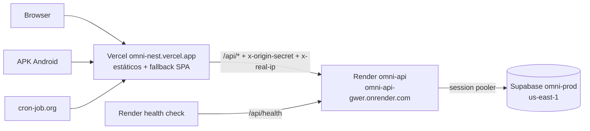
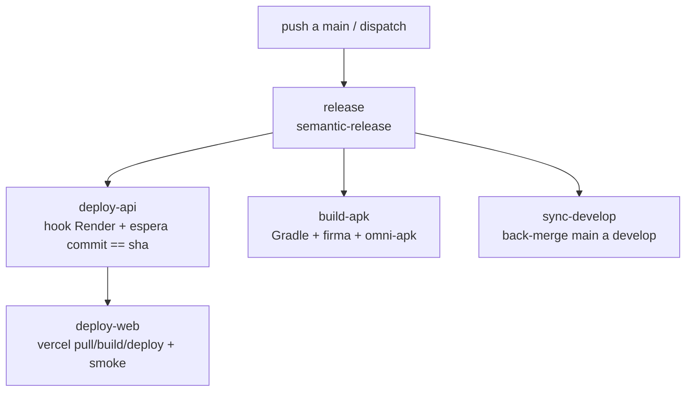

# Deployment y operación en producción

Web en **Vercel**, API en **Render** (Docker, plan free), base en **Supabase** (`omni-prod`) y APK Android en el repo privado `Leancoggiola/omni-apk`. Todo se deploya desde el workflow **Release & Deploy** al mergear a `main`.

---

## Arquitectura



- Web y mobile entran **siempre** por Vercel (mismo origen). Mobile no lleva ningún secreto en el bundle.
- La API responde 403 a lo que no traiga `x-origin-secret` (excepto `/api/health*`). Un request directo a `onrender.com/api/media` da 403.
- `GET /api/health`: liveness sin DB (Render y pipeline). `GET /api/health/ready`: hace `SELECT 1` (keep-alive y smoke).

| Servicio | URL                                                    |
| -------- | ------------------------------------------------------ |
| Web      | `https://omni-nest.vercel.app`                         |
| API      | `https://omni-api-gwer.onrender.com` (no usar directo) |
| Ready    | `https://omni-nest.vercel.app/api/health/ready`        |

La config de Render está en [`render.yaml`](../../render.yaml) (rama `main`, auto-deploy off, health `/api/health`) y la de Vercel en `apps/web/vercel.json` (proxy `/api`, fallback SPA, deploys por Git desactivados).

---

## Pipeline "Release & Deploy"

Dispara con push a `main` y con `workflow_dispatch` (inputs `redeploy`, `build_apk`, `upload_apk`). `concurrency` encola los runs sin cancelar.



| Job            | Hace                                                                                                                              |
| -------------- | --------------------------------------------------------------------------------------------------------------------------------- |
| `release`      | semantic-release; calcula `sha`, `tag`, `prev_tag`, `version`, `mobile_changed`.                                                  |
| `deploy-api`   | POST al deploy hook de Render y polling a `/api/health` hasta `commit == sha` (timeout 20 min). Las migraciones corren al inicio. |
| `deploy-web`   | Tras la API: `vercel pull/build/deploy --prod`. Smoke: `/api/health/ready` 200 con el sha nuevo y `/profile` 200.                 |
| `build-apk`    | Solo si cambió `apps/mobile` o `packages/shared` (o dispatch con `build_apk`). Publica en `omni-apk` o deja artifact de 7 días.   |
| `sync-develop` | Back-merge de `main` a `develop`.                                                                                                 |

Solo `feat`, `fix`, `perf` o `BREAKING CHANGE` generan release. `backup.yml` es independiente (ver [Backups](#backups)).

---

## Secrets y variables

### GitHub (environment `Production`)

| Nombre                             | Tipo     | De dónde sale                                                                                  |
| ---------------------------------- | -------- | ---------------------------------------------------------------------------------------------- |
| `RELEASE_TOKEN`                    | secret   | PAT de GitHub (`repo`); renovar antes de que venza.                                            |
| `RENDER_DEPLOY_HOOK_PROD`          | secret   | Render → Settings → Deploy Hook.                                                               |
| `VERCEL_TOKEN`                     | secret   | Vercel → Account Settings → Tokens.                                                            |
| `VERCEL_ORG_ID`                    | secret   | `.vercel/project.json` tras `vercel link`.                                                     |
| `VERCEL_PROJECT_ID`                | secret   | Ídem.                                                                                          |
| `ANDROID_KEYSTORE_BASE64`          | secret   | `base64` de `omni-release.jks` (generada con `keytool`).                                       |
| `ANDROID_KEYSTORE_PASSWORD`        | secret   | Elegida al generar la keystore.                                                                |
| `ANDROID_KEY_ALIAS`                | secret   | Alias de la keystore (`omni`).                                                                 |
| `ANDROID_KEY_PASSWORD`             | secret   | Elegida al generar la keystore.                                                                |
| `APK_REPO_TOKEN`                   | secret   | PAT fine-grained, Contents: write solo sobre `omni-apk`.                                       |
| `PROD_DIRECT_URL`                  | secret   | Supabase `omni-prod` → **session pooler** (5432).                                              |
| `BACKUP_S3_ACCESS_KEY_ID`          | secret   | Token del bucket de backups con permiso **solo de escritura** (sin borrar). Lo usa `backup`.   |
| `BACKUP_S3_SECRET_ACCESS_KEY`      | secret   | Par del anterior.                                                                              |
| `BACKUP_S3_READ_ACCESS_KEY_ID`     | secret   | Token del mismo bucket con permiso **solo de lectura**. Lo usa `restore-test`.                 |
| `BACKUP_S3_READ_SECRET_ACCESS_KEY` | secret   | Par del anterior.                                                                              |
| `BACKUP_AGE_IDENTITY`              | secret   | Clave privada `age` **A** (CI): solo la línea `AGE-SECRET-KEY-…`. La usa la prueba de restore. |
| `BACKUP_S3_ENDPOINT`               | variable | Endpoint S3 del bucket privado (R2: `https://<account>.r2.cloudflarestorage.com`).             |
| `BACKUP_S3_BUCKET`                 | variable | Nombre del bucket privado de backups.                                                          |
| `BACKUP_AGE_RECIPIENT`             | variable | Clave pública de la clave **A**.                                                               |
| `BACKUP_AGE_RECIPIENT_RECOVERY`    | variable | Clave pública de la clave **B** de recuperación (la privada vive solo fuera de GitHub).        |
| `PROD_WEB_URL`                     | variable | `https://omni-nest.vercel.app`; también es la `EXPO_PUBLIC_API_URL` del APK.                   |

Todos los secrets y variables del release y de los backups viven en el environment `Production`, que limita los deploys a `main` y `develop`, y cada job que los usa declara `environment: Production`. El único secret a nivel de repo es `CLAUDE_CODE_OAUTH_TOKEN` (revisión automática de PRs). `VERCEL_TOKEN` se pasa solo a los steps que lo usan (`vercel pull`, `deploy` y la verificación de `ORIGIN_SECRET`), no al build.

### Render (env vars, `sync: false`)

| Variable                                  | De dónde sale                                                                          |
| ----------------------------------------- | -------------------------------------------------------------------------------------- |
| `DATABASE_URL`                            | Supabase omni-prod → transaction pooler (6543, `?pgbouncer=true`).                     |
| `DIRECT_URL`                              | Supabase omni-prod → session pooler (5432). Obligatoria.                               |
| `JWT_ACCESS_SECRET`, `JWT_REFRESH_SECRET` | `openssl rand -base64 32`, distintos de dev.                                           |
| `ORIGIN_SECRET`                           | `openssl rand -base64 32`; **igual** que en Vercel. En prod, sin él la API no arranca. |
| `CORS_ORIGIN`                             | `https://omni-nest.vercel.app`                                                         |
| `TMDB_API_KEY`                            | themoviedb.org/settings/api                                                            |
| `ADMIN_USERNAME`, `ADMIN_PASSWORD`        | A elección (password fuerte); los usa el seed.                                         |
| `RATE_LIMIT_GLOBAL_MAX`                   | Opcional, default 300 por 15 min.                                                      |

### Vercel (proyecto `omni-nest`, environment Production)

| Variable        | De dónde sale                                                                                                                                   |
| --------------- | ----------------------------------------------------------------------------------------------------------------------------------------------- |
| `ORIGIN_SECRET` | El mismo valor que en Render. `vercel.json` lo inyecta como `x-origin-secret`. Si falta, el header llega literal y la API rechaza todo con 403. |

### Primera vez

Seed del admin, una sola vez. Los valores se leen sin eco, así no quedan en el historial del shell:

```bash
read -rs -p "DATABASE_URL: " DATABASE_URL; echo; export DATABASE_URL
read -rs -p "ADMIN_PASSWORD: " ADMIN_PASSWORD; echo; export ADMIN_PASSWORD
NODE_ENV=production ADMIN_USERNAME=<usuario> pnpm --filter api exec prisma db seed
unset DATABASE_URL ADMIN_PASSWORD
```

---

## Keep-alive

Render free duerme la API sin tráfico y Supabase free se pausa tras 7 días sin actividad. [cron-job.org](https://cron-job.org) (zona `America/Argentina/Buenos_Aires`) pega a `https://omni-nest.vercel.app/api/health/ready`:

| Job           | Horario ART                   | Notificación    | Nota                                                                                      |
| ------------- | ----------------------------- | --------------- | ----------------------------------------------------------------------------------------- |
| `keep-alive`  | cada 10 min, de 7:00 a 1:59   | Mail ante falla | Mantiene despierta la API y toca la DB.                                                   |
| `despertador` | todos los días a las **6:55** | Ninguna         | cron-job.org corta a los 30 s y el cold start dura ~1 min: "falla" pero despierta la API. |

**Ventana fría:** de 2:00 a 7:00 ART la API duerme (≈600 de las 750 h free por mes). El primer request en frío tarda ~1 min; web y mobile muestran "Despertando el servidor…" y reintentan hasta ~90 s.

cron-job.org deshabilita un job tras más de 25 fallas seguidas; el mail avisa antes.

---

## Backups

`backup.yml` corre los domingos 07:00 UTC (y por `workflow_dispatch`): `pg_dump -Fc` sobre `PROD_DIRECT_URL`, cifrado con `age` para **dos destinatarios** (clave A de CI y clave B de recuperación) y subido a un **bucket privado** S3-compatible (Cloudflare R2), prefijo `omni/`. No se publica como artifact del repo, que es público. En el bucket hay que configurar a mano la retención de 90 días (regla de ciclo de vida) y activar el versionado o un bloqueo de objetos, para que un token comprometido no pueda borrar los backups. `backup` usa un token sin permiso de borrado y `restore-test` uno de solo lectura. `restore-test` también falla si el último backup tiene más de 8 días.

El día 1 de cada mes 08:00 UTC (o con `workflow_dispatch` y `restore_test=true`) corre `restore-test`: baja el último backup, lo descifra con la clave A, lo restaura en un Postgres 17 efímero del job y verifica que el schema y `_prisma_migrations` tengan datos. Si falla, el backup no es confiable.

**Claves `age`:** se generan con `age-keygen`, una para CI (A) y otra de recuperación (B). La privada de B se guarda en un gestor de contraseñas o un disco aparte, nunca en GitHub. `age-key*`, `*.age` y `*.dump` están en `.gitignore`.

---

## Runbooks

### Rollback

1. **API:** Render → servicio → Deploys → deploy anterior sano → **Rollback**.
2. **Web:** `vercel rollback` (o Vercel → Deployments → Promote to Production del deploy anterior).
3. Las **migraciones van solo hacia adelante**: no volver a una API anterior al schema actual. Ante un bug en prod, preferir un **hotfix** (fix a `main` o PR normal y release).

### Re-build y re-deploy manual

1. GitHub → Actions → **Release & Deploy** → **Run workflow** sobre `main`.
2. `redeploy=true`: deploya API y web desde el HEAD de `main`, sin release.
3. `build_apk=true`: buildea el APK del último tag. Con `upload_apk=false` queda como artifact de 7 días. Si el release ya existe en `omni-apk`, el job falla en vez de pisarlo.
4. Solo la API: `curl -s "$RENDER_DEPLOY_HOOK_PROD"`.

### Restore de backup

1. Bajar el `.age` deseado del bucket privado (prefijo `omni/`): `aws s3 cp s3://<bucket>/omni/<archivo>.dump.age . --endpoint-url <BACKUP_S3_ENDPOINT>`.
2. Descifrar con la clave privada de recuperación (B): `age -d -i age-key-recovery.txt -o omni.dump omni.dump.age`
3. Restaurar (probar antes contra el `db` local de docker-compose):
   ```bash
   pg_restore --no-owner --no-privileges --clean --if-exists -d "<DIRECT_URL destino>" omni.dump
   ```
4. Verificar con `/api/health/ready` y un login.

### Rotación de secretos

1. **`ORIGIN_SECRET`:** el guard compara un único valor, así que Render y Vercel cambian **a la vez**. Generar uno nuevo, cargarlo en Vercel (Production) y en Render (**Save only**), y forzar `redeploy` (Render se reinicia y Vercel necesita un deploy nuevo). Hay unos minutos de 403: hacerlo en horario tranquilo.
2. **JWT:** cambiar `JWT_ACCESS_SECRET` y `JWT_REFRESH_SECRET` en Render y reiniciar. Invalida todas las sesiones.
3. **Keystore:** no se rota. Si se pierde, hay que desinstalar y reinstalar el APK (los datos viven en el servidor). Guardar `omni-release.jks` con backup fuera del repo.
4. **Tokens** (`RELEASE_TOKEN`, `APK_REPO_TOKEN`, `VERCEL_TOKEN`, `BACKUP_S3_*`): regenerar y actualizar el secret en el environment `Production`. Con PAT, usar vencimiento y revocar el anterior cuando el primer run con el nuevo pase.
5. **Claves `age`:** al rotar la clave A, actualizar `BACKUP_AGE_IDENTITY` y `BACKUP_AGE_RECIPIENT` a la vez; los backups viejos solo se abren con la clave con la que se cifraron. La B (recuperación) se rota igual con `BACKUP_AGE_RECIPIENT_RECOVERY`.

### Instalar el APK

1. En el celular, abrir los releases de `Leancoggiola/omni-apk` (repo privado: iniciar sesión con la cuenta con acceso).
2. Bajar `omni-vX.Y.Z.apk`.
3. Permitir la instalación desde orígenes desconocidos para la app que lo abre.
4. Instalar. Las actualizaciones se instalan encima (misma keystore, `versionCode` creciente).

### Supabase pausado

1. Dashboard → `omni-prod` → **Restore project**.
2. Esperar a que quede activo y chequear `/api/health/ready`.
3. Revisar por qué falló el keep-alive en cron-job.org (mails, jobs deshabilitados) y reactivarlo.

### Cron de backup deshabilitado

GitHub deshabilita los cron de repos públicos tras 60 días sin actividad (llega un mail).

1. Actions → **Backup** → **Enable workflow**.
2. Correrlo a mano con `workflow_dispatch` y confirmar que se genera el artifact.

---

## Riesgos y límites free

| Límite                | Detalle                                                                                                                                                                                                                |
| --------------------- | ---------------------------------------------------------------------------------------------------------------------------------------------------------------------------------------------------------------------- |
| Render 750 h/mes      | Con la ventana fría se usan ≈600 h. No sumar otros servicios free 24/7: si se agotan, Render suspende todo hasta el mes próximo.                                                                                       |
| Supabase 7 días       | Pausa por inactividad; el keep-alive la evita. Si falla una semana entera, restaurar a mano.                                                                                                                           |
| Proxy de Vercel 120 s | Tope del cold start de Render (~1 min). Más allá, 504 y el cliente reintenta.                                                                                                                                          |
| `transforms` en Hobby | **Pendiente de verificar** con un deploy de preview manual antes del cutover. El header `x-origin-secret` depende de que funcione en el plan. Fallback: `rewrites` sin guard y `trust proxy` 2 (rate limit más débil). |
| `RELEASE_TOKEN`       | Si vence, el release falla (de forma visible). Renovar antes.                                                                                                                                                          |
| Cron de GitHub        | Se deshabilita a los 60 días sin actividad.                                                                                                                                                                            |
| Migraciones           | Solo hacia adelante: corregir con hotfix, no con rollback de API.                                                                                                                                                      |
