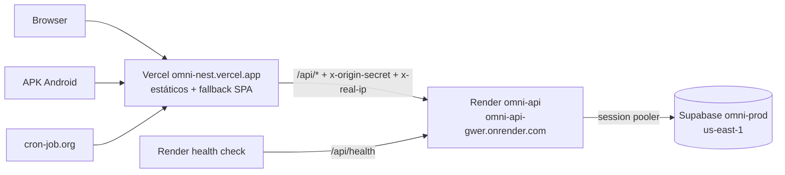
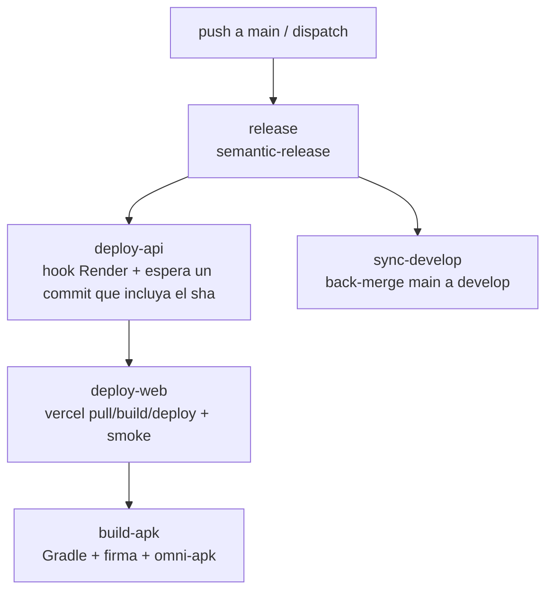

# Deployment y operación en producción

Web en **Vercel**, API en **Render** (Docker, plan free), base en **Supabase** (`omni-prod`) y APK Android en el repo privado `Leancoggiola/omni-apk`. Todo se deploya desde el workflow **Release & Deploy** al mergear a `main`.

---

## Arquitectura



- Web y mobile entran **siempre** por Vercel (mismo origen). Mobile no lleva ningún secreto en el bundle.
- La API responde 403 a lo que no traiga `x-origin-secret` (excepto `/api/health*`). Un request directo a `onrender.com/api/media` da 403.
- `GET /api/health`: liveness sin DB (Render y pipeline). `GET /api/health/ready`: hace `SELECT 1` (keep-alive y smoke).

| Servicio | URL                                                    |
| -------- | ------------------------------------------------------ |
| Web      | `https://omni-nest.vercel.app`                         |
| API      | `https://omni-api-gwer.onrender.com` (no usar directo) |
| Ready    | `https://omni-nest.vercel.app/api/health/ready`        |

[`render.yaml`](../../render.yaml) documenta la config de Render (Docker con `apps/api/Dockerfile`, rama `main`, auto-deploy off, health `/api/health`), pero el servicio no está atado al Blueprint: esa config se carga a mano en el dashboard y no se sincroniza sola. `render.yaml` lista las variables obligatorias y `NODE_ENV`; las opcionales están en [la tabla de Render](#render-env-vars-sync-false). La de Vercel vive en `apps/web/vercel.json`: proxy `/api`, cabeceras de seguridad en todo lo que no es `/api` (CSP, `X-Content-Type-Options`, `Referrer-Policy`), caché inmutable en `/assets`, fallback SPA y deploys por Git desactivados. `Strict-Transport-Security` no está en `vercel.json`: la agrega Vercel por defecto en los dominios `*.vercel.app`, y con un dominio propio hay que revisarla.

---

## Pipeline "Release & Deploy"

Dispara con push a `main` y con `workflow_dispatch` (inputs `redeploy`, `build_apk`, `upload_apk`). `concurrency` encola los runs sin cancelar.



| Job            | Hace                                                                                                                                                                                                        |
| -------------- | ----------------------------------------------------------------------------------------------------------------------------------------------------------------------------------------------------------- |
| `release`      | semantic-release; calcula `sha`, `tag`, `prev_tag`, `version`, `mobile_changed`.                                                                                                                            |
| `deploy-api`   | POST al deploy hook de Render y polling a `/api/health` hasta que el commit publicado sea el sha o un descendiente suyo (`git merge-base --is-ancestor`; timeout 20 min). Las migraciones corren al inicio. |
| `deploy-web`   | Tras la API: `vercel pull/build/deploy --prod`. Smoke: `/api/health/ready` 200 con el sha nuevo y `/profile` 200.                                                                                           |
| `build-apk`    | Solo si cambió `apps/mobile` o `packages/shared` (o dispatch con `build_apk`). Publica en `omni-apk` o deja artifact de 7 días.                                                                             |
| `sync-develop` | Back-merge de `main` a `develop`.                                                                                                                                                                           |

Solo `feat`, `fix`, `perf` o `BREAKING CHANGE` generan release. `backup.yml` es independiente (ver [Backups](#backups)).

---

## Secrets y variables

### GitHub (environment `Production`)

| Nombre                             | Tipo     | De dónde sale                                                                                                                                               |
| ---------------------------------- | -------- | ----------------------------------------------------------------------------------------------------------------------------------------------------------- |
| `RELEASE_TOKEN`                    | secret   | PAT de GitHub (`repo`); renovar antes de que venza.                                                                                                         |
| `RENDER_DEPLOY_HOOK_PROD`          | secret   | Render → Settings → Deploy Hook.                                                                                                                            |
| `VERCEL_TOKEN`                     | secret   | Vercel → Account Settings → Tokens, con scope al team completo, no limitado a un proyecto (ver [Vercel](#vercel-proyecto-omni-web-environment-production)). |
| `VERCEL_ORG_ID`                    | secret   | Team ID (`team_…`), de `.vercel/project.json` tras `vercel link --project omni-web`.                                                                        |
| `VERCEL_PROJECT_ID`                | secret   | Ídem.                                                                                                                                                       |
| `ANDROID_KEYSTORE_BASE64`          | secret   | `base64` de `omni-release.jks` (generada con `keytool`).                                                                                                    |
| `ANDROID_KEYSTORE_PASSWORD`        | secret   | Elegida al generar la keystore.                                                                                                                             |
| `ANDROID_KEY_ALIAS`                | secret   | Alias de la keystore (`omni`).                                                                                                                              |
| `ANDROID_KEY_PASSWORD`             | secret   | Elegida al generar la keystore.                                                                                                                             |
| `APK_REPO_TOKEN`                   | secret   | PAT fine-grained, Contents: write solo sobre `omni-apk`.                                                                                                    |
| `PROD_DIRECT_URL`                  | secret   | Supabase `omni-prod` → **session pooler** (5432).                                                                                                           |
| `BACKUP_S3_ACCESS_KEY_ID`          | secret   | Access key del usuario IAM `omni-backup-writer`: solo `s3:PutObject` sobre `omni/*`. Lo usa `backup`.                                                       |
| `BACKUP_S3_SECRET_ACCESS_KEY`      | secret   | Par del anterior.                                                                                                                                           |
| `BACKUP_S3_READ_ACCESS_KEY_ID`     | secret   | Access key del usuario IAM `omni-backup-reader`: solo `s3:GetObject` y `s3:ListBucket`. Lo usa `restore-test`.                                              |
| `BACKUP_S3_READ_SECRET_ACCESS_KEY` | secret   | Par del anterior.                                                                                                                                           |
| `BACKUP_AGE_IDENTITY`              | secret   | Clave privada `age` **A** (CI): solo la línea `AGE-SECRET-KEY-…`. La usa la prueba de restore.                                                              |
| `BACKUP_S3_ENDPOINT`               | variable | Opcional: solo para un S3-compatible que no sea AWS (p. ej. R2). En AWS S3 se deja sin definir.                                                             |
| `BACKUP_S3_REGION`                 | variable | Región del bucket (p. ej. `us-east-1`).                                                                                                                     |
| `BACKUP_S3_BUCKET`                 | variable | Nombre del bucket privado de backups.                                                                                                                       |
| `BACKUP_AGE_RECIPIENT`             | variable | Clave pública de la clave **A**.                                                                                                                            |
| `BACKUP_AGE_RECIPIENT_RECOVERY`    | variable | Clave pública de la clave **B** de recuperación (la privada vive solo fuera de GitHub).                                                                     |
| `PROD_WEB_URL`                     | variable | `https://omni-nest.vercel.app`; también es la `EXPO_PUBLIC_API_URL` del APK.                                                                                |

Todos los secrets y variables del release y de los backups viven en el environment `Production`, que limita los deploys a `main` y `develop`, y cada job que los usa declara `environment: Production`. El único secret a nivel de repo es `CLAUDE_CODE_OAUTH_TOKEN` (revisión automática de PRs). `VERCEL_TOKEN` se pasa solo a los steps que lo usan (`vercel pull`, `deploy` y la verificación de `ORIGIN_SECRET`), no al build.

### Render (env vars, `sync: false`)

Settings del servicio `omni-api`: runtime **Docker**, Dockerfile `./apps/api/Dockerfile`, context `.`, rama `main`, **Auto-Deploy: Off** (deploya solo el hook del pipeline) y health check `/api/health`. Node sale del `FROM node:24-alpine` del Dockerfile: no definir `NODE_VERSION`.

Al editar variables, guardar con **Save only**. "Save and deploy" y "Save, rebuild and deploy" deployan el HEAD de `main` en ese momento, fuera del pipeline.

| Variable                                          | De dónde sale                                                                                                          |
| ------------------------------------------------- | ---------------------------------------------------------------------------------------------------------------------- |
| `NODE_ENV`                                        | Opcional: el Dockerfile ya fija `ENV NODE_ENV=production`. Si se carga, tiene que ser `production`.                    |
| `DATABASE_URL`                                    | Supabase omni-prod → transaction pooler (6543, `?pgbouncer=true`).                                                     |
| `DIRECT_URL`                                      | Supabase omni-prod → session pooler (5432). Obligatoria: el entrypoint corre `prisma migrate deploy` con ella.         |
| `JWT_ACCESS_SECRET`, `JWT_REFRESH_SECRET`         | `openssl rand -base64 32`, distintos de dev y entre sí; la API no arranca con menos de 32 caracteres.                  |
| `ORIGIN_SECRET`                                   | `openssl rand -base64 32`; **igual** que en Vercel. En prod, sin él la API no arranca.                                 |
| `CORS_ORIGIN`                                     | `https://omni-nest.vercel.app`                                                                                         |
| `TMDB_API_KEY`                                    | themoviedb.org/settings/api → **API Read Access Token** (v4), no la API key v3.                                        |
| `JWT_ACCESS_EXPIRES_IN`, `JWT_REFRESH_EXPIRES_IN` | Opcionales, default `15m` y `7d`. Entero con unidad `s`, `m`, `h` o `d`; un valor inválido no deja arrancar la API.    |
| `JWT_REFRESH_EXPIRES_IN_MOBILE`                   | Opcional, default `90d`. Vigencia deslizante del refresh token de la app mobile (la web usa `JWT_REFRESH_EXPIRES_IN`). |
| `RATE_LIMIT_GLOBAL_MAX`                           | Opcional, default 300 por 15 min.                                                                                      |

`ADMIN_USERNAME` y `ADMIN_PASSWORD` no van en Render: la API no las lee y el seed corre desde una PC (ver [Primera vez](#primera-vez)).

En las URLs de Supabase el usuario es `postgres.<ref del proyecto>` y el host lleva la región del proyecto (`aws-0-us-east-1.pooler.supabase.com`). Un ref o una región equivocados dan `tenant/user … not found`; un password equivocado, `P1000`. Si el password tiene caracteres reservados (`@ : / # ? %`), va codificado en la URL.

### Vercel (proyecto `omni-web`, environment Production)

El proyecto se llama **`omni-web`** y su dominio de producción es `omni-nest.vercel.app`; vive en el team `leandros-projects`.

- `vercel link --project omni-web` sin `--yes`: con `--yes`, si el nombre no existe crea un proyecto nuevo en vez de fallar.
- El token del pipeline tiene que tener scope al **team completo**. La CLI lee el team antes que el proyecto, y con un token limitado a un proyecto (o de otra cuenta) falla con `Could not retrieve Project Settings` (la API responde `team_unauthorized`); con IDs que no existen, `Project not found`.

| Variable        | De dónde sale                                                                                                                                                           |
| --------------- | ----------------------------------------------------------------------------------------------------------------------------------------------------------------------- |
| `ORIGIN_SECRET` | El mismo valor que en Render, marcado como Sensitive. `vercel.json` lo inyecta como `x-origin-secret`. Si falta, el header llega literal y la API rechaza todo con 403. |

Settings del proyecto: Root Directory `apps/web` y Node.js Version `24.x`.

### Primera vez

Con la base vacía, migrar y sembrar el admin desde una PC **antes** del primer release: así el primer arranque de Render encuentra el schema al día y ya se puede iniciar sesión. Correrlo desde un checkout **sin** `apps/api/.env` (por ejemplo un worktree limpio): `prisma.config.ts` y el seed cargan `.env` con dotenv, y `prisma.config.ts` usa `DIRECT_URL` antes que `DATABASE_URL`, así que un `.env` de dev al lado podría apuntar los comandos a otra base. Los valores se leen sin eco, así no quedan en el historial del shell:

```bash
read -rs -p "DIRECT_URL (session pooler 5432): " DIRECT_URL; echo; export DIRECT_URL; export DATABASE_URL="$DIRECT_URL"
pnpm --filter api exec prisma migrate status   # base vacía: todas las migraciones pendientes
pnpm --filter api exec prisma migrate deploy
pnpm --filter api exec prisma migrate status   # Database schema is up to date!

read -rs -p "ADMIN_PASSWORD: " ADMIN_PASSWORD; echo; export ADMIN_PASSWORD
NODE_ENV=production ADMIN_USERNAME=<usuario> pnpm --filter api exec prisma db seed
unset DIRECT_URL DATABASE_URL ADMIN_PASSWORD
```

- Si el primer `migrate status` dice "up to date", la URL es de otra base: abortar.
- Si el seed imprime `Skipping admin seed`, falta `ADMIN_USERNAME` o `ADMIN_PASSWORD`: termina con código 0 pero no crea el admin.
- El seed no valida el usuario ni el password. El usuario tiene que cumplir las reglas del login (6 a 20 caracteres, solo letras y números); el seed y el login lo pasan a minúsculas. El login solo exige un password no vacío, pero conviene usar 8 a 72 caracteres, la regla de las contraseñas nuevas (registro y cambio de contraseña).
- Sin `SEED_DEMO`: con `NODE_ENV=production` el seed rechaza la demo.
- El seed no pisa un admin existente: para cambiar el usuario o el password, borrar la fila y volver a correrlo.

En PowerShell, `Read-Host -AsSecureString` cumple el papel de `read -rs`, y `[Uri]::EscapeDataString` codifica el password si se arma la URL a mano.

### Verificación post-deploy

1. `curl -I https://omni-nest.vercel.app/profile`: `Content-Security-Policy`, `X-Content-Type-Options: nosniff`, `Referrer-Policy` y `Strict-Transport-Security` (esta última la pone Vercel). Un archivo de `/assets/` trae `Cache-Control: public, max-age=31536000, immutable`.
2. `curl https://omni-nest.vercel.app/api/health/ready`: 200 con el commit desplegado. `/api/health*` no pasa por el guard, así que el guard se prueba con `/api/media`: por Vercel 401 (pasó el guard, falta sesión) y directo a `https://omni-api-gwer.onrender.com/api/media` 403.
3. Web: tras el login hay dos cookies `HttpOnly`, `Secure` y `SameSite=Strict`: `access_token` (path `/api`) y `refresh_token` (path `/api/auth`). Borrando `access_token` y recargando, la sesión sigue (refresh). El logout borra las dos y cierra solo esa sesión.
4. APK: login, reabrir la app pasada la vida del access token sin perder la sesión, y logout.

---

## Keep-alive

Render free duerme la API sin tráfico y Supabase free se pausa tras 7 días sin actividad. [cron-job.org](https://cron-job.org) (zona `America/Argentina/Buenos_Aires`) pega a `https://omni-nest.vercel.app/api/health/ready`:

| Job           | Horario ART                   | Crontab               | Notificación    | Nota                                                                                      |
| ------------- | ----------------------------- | --------------------- | --------------- | ----------------------------------------------------------------------------------------- |
| `keep-alive`  | cada 10 min, de 7:00 a 1:59   | `*/10 0,1,7-23 * * *` | Mail ante falla | Mantiene despierta la API y toca la DB.                                                   |
| `despertador` | todos los días a las **6:55** | `55 6 * * *`          | Ninguna         | cron-job.org corta a los 30 s y el cold start dura ~1 min: "falla" pero despierta la API. |

Los jobs se crean con el horario **Personalizado** (zona del job `America/Argentina/Buenos_Aires`), método GET y "Guardar respuestas en el historial" activado. La cuenta de cron-job.org es del mantenedor: si no se puede entrar, los jobs se recrean con esta tabla.

**Ventana fría:** de 2:00 a 7:00 ART la API duerme (≈600 de las 750 h free por mes). El primer request en frío tarda ~1 min; web y mobile muestran "Despertando el servidor…" y reintentan hasta ~90 s.

cron-job.org deshabilita un job tras más de 25 fallas seguidas; el mail avisa antes. Tras una falla no manda otro aviso hasta que el job vuelva a dar 200.

**Verificar:** en el historial de `keep-alive` las ejecuciones de 7:10 a 1:50 deben dar `200`; la de 7:00 puede dar timeout si la API durmió. Sin jobs activos la API se duerme también dentro de la ventana (así pasó el 25/10 de 2026, al no existir los jobs).

**Plan:** se mantiene Render free con keep-alive. Starter (US$ 7/mes, siempre activo, sin cold start) queda como alternativa si el keep-alive falla seguido o el consumo se acerca a 750 h; el cambio se hace a mano en el dashboard y en `plan` de `render.yaml`. El consumo se revisa a fin de noviembre (#209).

---

## Backups

`backup.yml` corre los domingos 07:00 UTC (y por `workflow_dispatch`): `pg_dump -Fc` sobre `PROD_DIRECT_URL`, cifrado con `age` para **dos destinatarios** (clave A de CI y clave B de recuperación) y subido a un **bucket privado de AWS S3**, prefijo `omni/`. No se publica como artifact del repo, que es público. El bucket tiene bloqueado todo acceso público, cifrado por defecto, versionado activado y una regla de ciclo de vida que borra a los 90 días (se configura a mano en AWS). `backup` usa un usuario IAM que solo puede subir y `restore-test` uno que solo puede leer, así que un token comprometido no borra backups. `restore-test` también falla si el último backup tiene más de 8 días.

El día 1 de cada mes 08:00 UTC (o con `workflow_dispatch` y `restore_test=true`) corre `restore-test`: baja el último backup, lo descifra con la clave A, lo restaura en un Postgres 17 efímero del job y verifica que haya tablas, filas en `_prisma_migrations` y al menos un usuario. Con `omni-prod` vacía (antes de migrar y sembrar) falla a propósito. Si falla, el backup no es confiable.

**Claves `age`:** se generan con `age-keygen`, una para CI (A) y otra de recuperación (B). La privada de B se guarda en un gestor de contraseñas o un disco aparte, nunca en GitHub. `age-key*`, `*.age` y `*.dump` están en `.gitignore`.

---

## Runbooks

### Rollback

1. **API:** Render → servicio → Deploys → deploy anterior sano → **Rollback**.
2. **Web:** `vercel rollback` (o Vercel → Deployments → Promote to Production del deploy anterior).
3. Las **migraciones van solo hacia adelante**: no volver a una API anterior al schema actual. Ante un bug en prod, preferir un **hotfix** (fix a `main` o PR normal y release).

### Re-build y re-deploy manual

1. GitHub → Actions → **Release & Deploy** → **Run workflow** sobre `main`.
2. `redeploy=true`: deploya API y web desde el HEAD de `main`, sin release.
3. `build_apk=true`: buildea el APK del último tag. Con `upload_apk=false` queda como artifact de 7 días. Si el release ya existe en `omni-apk`, el job falla en vez de pisarlo.
4. Solo la API: `curl -s "$RENDER_DEPLOY_HOOK_PROD"`.

### Docker local

`docker-compose.yml` publica todos los puertos en `127.0.0.1` y fija las imágenes por digest (Dependabot las actualiza).

| Servicio  | Para qué                                                                                                 | Puerto                  |
| --------- | -------------------------------------------------------------------------------------------------------- | ----------------------- |
| `db`      | Postgres de desarrollo con volumen persistente. Sirve para ensayar un restore de backup.                 | `5432`                  |
| `api`     | Imagen de producción de la API (`apps/api/Dockerfile`), con `apps/api/.env`. Para probar el build local. | `3000`                  |
| `db-test` | Postgres efímero (tmpfs) para los tests de integración.                                                  | `${DB_TEST_PORT:-5433}` |
| `db-e2e`  | Postgres efímero (tmpfs) para la suite E2E.                                                              | `${DB_E2E_PORT:-5434}`  |

### Restore de backup

1. Bajar el `.age` deseado del bucket privado (prefijo `omni/`): `aws s3 cp s3://<bucket>/omni/<archivo>.dump.age .`.
2. Descifrar con la clave privada de recuperación (B): `age -d -i age-key-recovery.txt -o omni.dump omni.dump.age`
3. Restaurar (probar antes contra el `db` local de docker-compose):
   ```bash
   pg_restore --no-owner --no-privileges --clean --if-exists -d "<DIRECT_URL destino>" omni.dump
   ```
4. Verificar con `/api/health/ready` y un login.

### Rotación de secretos

1. **`ORIGIN_SECRET`:** el guard compara un único valor, así que Render y Vercel cambian **a la vez**. Generar uno nuevo, cargarlo en Vercel (Production) y en Render (**Save only**), y forzar `redeploy` (Render se reinicia y Vercel necesita un deploy nuevo). Hay unos minutos de 403: hacerlo en horario tranquilo.
2. **JWT:** cambiar `JWT_ACCESS_SECRET` y `JWT_REFRESH_SECRET` en Render y reiniciar. Invalida todas las sesiones.
3. **Keystore:** no se rota. Si se pierde, hay que desinstalar y reinstalar el APK (los datos viven en el servidor). Guardar `omni-release.jks` con backup fuera del repo.
4. **Tokens** (`RELEASE_TOKEN`, `APK_REPO_TOKEN`, `VERCEL_TOKEN`, `BACKUP_S3_*`): regenerar y actualizar el secret en el environment `Production`. Con PAT, usar vencimiento y revocar el anterior cuando el primer run con el nuevo pase.
5. **Claves `age`:** al rotar la clave A, actualizar `BACKUP_AGE_IDENTITY` y `BACKUP_AGE_RECIPIENT` a la vez; los backups viejos solo se abren con la clave con la que se cifraron. La B (recuperación) se rota igual con `BACKUP_AGE_RECIPIENT_RECOVERY`.

### Calendario de credenciales

Para reconstruir todo desde cero (otra PC, cuenta nueva) ver [setup-desde-cero.md](./setup-desde-cero.md).

Qué vence y cuándo hay que renovarlo. Los PAT de GitHub y los tokens de Vercel vencen solos; las claves de AWS no, pero se rotan igual. Anotar en la columna "Vence" la fecha real al crear o renovar.

| Credencial                                  | Dónde se crea                                            | Vence                              | Renovar                         | Si no se renueva                                  |
| ------------------------------------------- | -------------------------------------------------------- | ---------------------------------- | ------------------------------- | ------------------------------------------------- |
| `RELEASE_TOKEN` (PAT)                       | github.com/settings/tokens                               | Al vencimiento elegido (≤ 90 días) | 1 semana antes                  | El release falla en `release` y `sync-develop`    |
| `APK_REPO_TOKEN` (PAT fine-grained)         | github.com/settings/personal-access-tokens               | Al vencimiento elegido (≤ 90 días) | 1 semana antes                  | `build-apk` no publica en `omni-apk`              |
| `VERCEL_TOKEN`                              | vercel.com/account/tokens                                | Al vencimiento elegido             | 1 semana antes                  | `deploy-web` falla                                |
| `BACKUP_S3_*` (claves IAM, writer y reader) | AWS → IAM → Users → Security credentials → Access keys   | No vencen                          | Cada 12 meses, o si se filtran  | Nada hasta que se filtren; rotar es higiene       |
| `BACKUP_AGE_*` (claves `age` A y B)         | `age-keygen`                                             | No vencen                          | Solo si se pierde o expone una  | No se puede descifrar un backup si se pierde la B |
| `PROD_DIRECT_URL` (password de la DB)       | Supabase → Database → Settings → Reset database password | No vence                           | Si se filtra; actualizar Render | Backup y restore fallan si el password cambia     |
| `ANDROID_KEYSTORE_*`                        | `keytool`                                                | No vence (validez de 10000 días)   | Nunca (ver Rotación)            | Sin la keystore no hay actualizaciones del APK    |
| `RENDER_DEPLOY_HOOK_PROD`                   | Render → Settings → Deploy Hook                          | No vence                           | Si se filtra                    | —                                                 |

Rotar una clave IAM sin cortar el servicio: crear la segunda access key del mismo usuario, cargarla en GitHub, correr `Backup` a mano, y recién entonces desactivar y borrar la anterior. Cada usuario admite dos claves a la vez.

El borrado a los 90 días de los **backups** es una regla del bucket (`expirar-90-dias`), no una credencial: no hay que repetirla ni renovarla.

### Instalar el APK

1. En el celular, abrir los releases de `Leancoggiola/omni-apk` (repo privado: iniciar sesión con la cuenta con acceso).
2. Bajar `omni-vX.Y.Z.apk`.
3. Permitir la instalación desde orígenes desconocidos para la app que lo abre.
4. Instalar. Las actualizaciones se instalan encima (misma keystore, `versionCode` creciente).

### Supabase pausado

1. Dashboard → `omni-prod` → **Restore project**.
2. Esperar a que quede activo y chequear `/api/health/ready`.
3. Revisar por qué falló el keep-alive en cron-job.org (mails, jobs deshabilitados) y reactivarlo.

### Cron de backup deshabilitado

GitHub deshabilita los cron de repos públicos tras 60 días sin actividad (llega un mail).

1. Actions → **Backup** → **Enable workflow**.
2. Correrlo a mano con `workflow_dispatch` y confirmar que sube un `.dump.age` nuevo bajo `omni/` en el bucket.

---

## Riesgos y límites free

| Límite                | Detalle                                                                                                                                                                                                                           |
| --------------------- | --------------------------------------------------------------------------------------------------------------------------------------------------------------------------------------------------------------------------------- |
| Render 750 h/mes      | Con la ventana fría se usan ≈600 h. No sumar otros servicios free 24/7: si se agotan, Render suspende todo hasta el mes próximo.                                                                                                  |
| Supabase 7 días       | Pausa por inactividad; el keep-alive la evita. Si falla una semana entera, restaurar a mano.                                                                                                                                      |
| Proxy de Vercel 120 s | Tope del cold start de Render (~1 min). Más allá, 504 y el cliente reintenta.                                                                                                                                                     |
| `transforms` en Hobby | Verificado en el cutover de #94: por Vercel `/api/media` da 401 y directo a Render 403, así que el proxy inyecta `x-origin-secret`. Si Vercel lo quitara del plan: `rewrites` sin guard y `trust proxy` 2 (rate limit más débil). |
| `RELEASE_TOKEN`       | Si vence, el release falla (de forma visible). Renovar antes.                                                                                                                                                                     |
| Cron de GitHub        | Se deshabilita a los 60 días sin actividad.                                                                                                                                                                                       |
| Migraciones           | Solo hacia adelante: corregir con hotfix, no con rollback de API.                                                                                                                                                                 |
